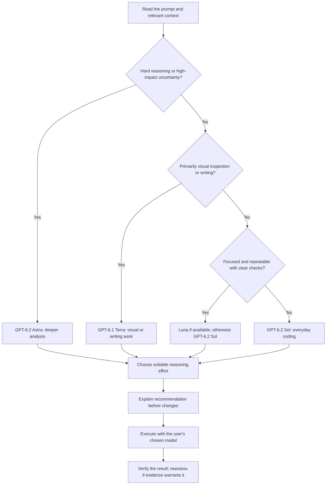

# Choosing a model for this project

Reviewed: 2026-11-17. Recommendations below are project heuristics, not benchmark results or promises about quality. Names and access can change; choose from the models actually available in your client. Consult the [official model guide](https://learn.chatgpt.com/docs/models) when this list needs updating.

## Model, agent, skill, and tool

- A **model** is the engine doing the reasoning and generation.
- An **agent** is a working assistant using a model, instructions, and tools to carry out a task. Choosing a model does not itself create another agent.
- A **skill** is reusable guidance for a task, such as our SOLID workflow.
- A **tool or MCP integration** provides an action or access, such as reading Figma. Choosing a stronger model does not grant missing permissions or integrations.

## Decision diagram

Use the table if your Markdown viewer cannot render Mermaid. This is a decision aid; task risk can override the visual or repetitive branch. A screenshot task involving complex application behavior may need both careful analysis and code validation.

## Suggested choices

| Model | Suggested use here | Examples |
| --- | --- | --- |
| GPT-6.2 Sol (`gpt-6.2-sol`) | Default for ordinary development | Compose components, straightforward API integration, tests, docs, and routine Git operations |
| GPT-6.2 Astra (`gpt-6.2-astra`) | Difficult reasoning or consequential uncertainty | Diagnose a concurrency defect across layers, review a risky migration, or compare architectural tradeoffs |
| GPT-6.1 Terra (`gpt-6.1-terra`) | Visual understanding and writing | Compare screenshots, identify layout discrepancies, or clarify documentation; use Sol for substantial implementation when appropriate |
| GPT-6 Luna (`gpt-6-luna`), if offered | Narrow, repeatable work with clear success criteria | Structured extraction, summarizing test output, or a tightly scoped mechanical edit |

The official guide positions Sol for everyday work, Astra for demanding projects, Terra for visual/writing tasks, and Luna for focused tasks. It also reports fewer credits per token for GPT-6.2 Sol than Astra at Standard speed. Exact cost depends on the account, speed, and usage; no fixed prices or guaranteed savings are assumed here. [Official model guidance](https://learn.chatgpt.com/docs/models#recommended-models)

## Reasoning effort and escalation

Start with the client's default effort. For a clear routine command, a lighter supported effort may be sufficient. For difficult debugging or migration planning, consider a higher effort. Higher effort generally takes longer and uses more tokens; use evidence from the task to justify it. Available effort labels vary by model and client. [Reasoning controls](https://learn.chatgpt.com/docs/models#pick-a-reasoning-effort)

If a lower-effort attempt fails, inspect the failure first: missing access, incomplete requirements, and broken tooling need direct fixes. Repeating an identical task with a stronger model does not resolve a permission problem. For difficult unresolved reasoning, recommend higher effort or Astra and explain what it should help determine. Do not silently change models, settings, or delegate work.

## Selecting the model

In the desktop app's Work or Codex view, use the model/reasoning control beneath the composer; if a Power slider is shown, Advanced exposes specific choices. In Codex CLI, use `/model`, or start a session with `codex -m gpt-6.2-sol`. Use the choices actually shown by your account. [Selection instructions](https://learn.chatgpt.com/docs/models#choose-a-model)

This project's instructions request recommendations; they do not configure automatic routing. If the assistant lacks a model-switching tool, the developer selects the model. When you want to make that choice before work begins, say: "Assess this task and recommend a model. Wait for my selection before editing."

## Examples from this project

| Prompt | Initial recommendation and reason |
| --- | --- |
| Commit the already-reviewed changes | Sol with light/default effort: inspect scope, then execute Git commands |
| Add a basic Pokemon list | Sol/default: bounded implementation with observable behavior |
| Compare Home with a screenshot | Terra: visual inspection; recommendations remain estimates without design measurements |
| Diagnose missing or duplicated paginated rows | Astra/higher effort if the cause spans requests, state, and storage; a localized known bug may only need Sol |
| Design a migration that preserves existing user data | Astra/higher effort for the risk analysis, followed by migration tests |
| Update rules and a model guide | Sol/default: focused documentation and source verification |

After application implementation, the handoff also leaves the tested app open on the relevant screen, with the device name and a short manual test path. Tests, evidence, and human review remain necessary regardless of the selected model.
